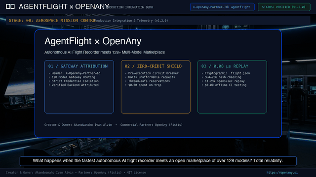

# AgentFlight (`agentflight`)

<p align="center">
  
</p>

[](https://github.com/codesphere-u/agentflight/actions/workflows/ci.yml)
[](https://pypi.org/project/agentflight-mcp/)
[](https://github.com/codesphere-u/agentflight/releases/tag/v1.6.0)
[](https://codesphere-u.github.io/agentflight/)
[](https://www.python.org/)
[-7c3aed.svg)](https://modelcontextprotocol.io/)
[-10b981?logo=vercel&logoColor=white)](https://agentflight-tau.vercel.app/mcp)
[](https://m8ven.ai/mcp/codesphere-u-agentflight-1ki1u7?s=readme)
[](https://m8ven.ai/mcp/codesphere-u/agentflight?s=readme)
[-brightgreen.svg)](tests/)
[](src/agentflight/)
[](LICENSE)

**The Flight Recorder, Runtime Policy Firewall, and `$0.00` Deterministic Replay Engine for AI Agents & MCP Servers.**

Record every LLM turn, stream chunk, and MCP tool call into a tamper-evident SHA-256 cassette (with API keys scrubbed automatically) — then **block unsafe calls (`PF001–PF007`)**, **stop infinite loops (`CB001–CB005`)**, **assert behavioral SLAs (`FlightContract`)**, **time-travel fork from any step**, **replay tests in `<0.02 ms` at `$0.00`**, and **auto-fix flaky MCP schemas (`TS001–TS010`)**.

> 🌐 **Try in Browser:** [Interactive Studio (Linter, Breaker & Policy Firewall Lab)](https://codesphere-u.github.io/agentflight/studio.html) · [Verified Proof](https://codesphere-u.github.io/agentflight/proof.html) · [22 Rules Reference](https://codesphere-u.github.io/agentflight/rules.html) · [Web Docs](https://codesphere-u.github.io/agentflight/docs.html)
>
> 📖 **Guides:** [30s Getting Started](docs/GETTING_STARTED.md) · [Copy-Paste Cookbook](docs/COOKBOOK.md) · [Policy Firewall & Contracts](docs/POLICY_AND_CONTRACTS.md) · [MCP & Coding Agents](docs/MCP_AND_AGENTS.md) · [Architecture](docs/architecture.md) · [`llms.txt`](llms.txt)
>
> ⚡ **Live Hosted MCP:** `claude mcp add --transport http agentflight https://agentflight-tau.vercel.app/mcp`
>
> ⭐ **Find this useful?** Star the repo and follow creator **[Akandwanaho Ivan Alvin](https://alvin.codesphereug.com/)**!

<p align="center">
  
</p>

<p align="center">
  <a href="https://glama.ai/mcp/servers/codesphere-u/agentflight">
    
  </a>
</p>

---

## Why Teams Adopt AgentFlight

| Production Agent Headache | Without AgentFlight | With AgentFlight (`v1.6.0`) |
| :--- | :--- | :--- |
| **Flaky, Expensive CI Tests** | Every pytest run takes `15–45s`, hits rate limits, and burns LLM credits | Record once, replay deterministically in **`2.83 µs/span` (`$0.00` spend)** |
| **Runaway Agent Loops & Burned Budgets** | Stuck `A -> B -> A -> B` tool cycles rack up `$20–$200` overnight | **`TrajectoryCircuitBreaker`** trips pre-execution on repeats, ping-pong & dollar caps |
| **Dangerous Tool Calls (SSRF / SQL / Secrets)** | Prompt-injected agent curls `169.254.169.254`, runs `DROP TABLE`, or leaks `sk-...` | **`TrajectoryPolicyEngine` (`PF001–PF007`)** blocks violations before execution |
| **Broken Tool Chains That Pass Naive Asserts** | Final string looks plausible while skipping auth or calling `delete_*` | **`FlightContract`** enforces `must_call`, `must_follow_order`, cost, latency & chain integrity |
| **Re-Paying Steps 0–N to Debug Step N+1** | Fixing a bug on step 7 means re-running steps 1–6 over and over | **Time-Travel Forking (`fork_at`)** branches at step `k` with counterfactual outputs (`$0.00`) |
| **Silent Tool-Calling Mistakes in MCP Suites** | Missing enums, ambiguous booleans, colliding tool names | **`ToolSmellLinter` (`TS001–TS010`) + `agentflight fix`** hardens schemas to Grade A |

Built on a **100% Python stdlib core** (`src/agentflight/` has zero third-party runtime dependencies) so it drops cleanly into any repo or CI container.

---

## Install in 10 Seconds

```bash
pip install agentflight-mcp && agentflight doctor --json
```

<details>
<summary>Other install options (uvx zero-install, source install, contributors)</summary>

```bash
# Run CLI or MCP server immediately with zero virtualenv setup
uvx --from agentflight-mcp agentflight demo

# Install v1.6.0 directly from GitHub
pip install "git+https://github.com/codesphere-u/agentflight.git@v1.6.0"

# Editable contributor install (with dev/test/server extras)
pip install -e ".[dev,server]"
```

</details>

---

## Get Value in 30 Seconds

### 1. Guard Live Agents Against Loops, Budget Overshoot & Unsafe Payloads

Protect any `OpenAI`, `AsyncOpenAI`, OpenRouter, vLLM, OpenAny, or `Anthropic` client (including `stream=True`) in 5 lines — while saving a redacted, SHA-256 tamper-evident cassette:

```python
from openai import OpenAI
from agentflight import (
    TrajectoryCircuitBreaker,
    TrajectoryPolicyEngine,
    wrap_openai,
)

guard = TrajectoryCircuitBreaker(
    max_identical_repeats=3,
    max_ping_pong_cycles=2,
    max_cost_usd=0.25,
    policy=TrajectoryPolicyEngine(mode="strict", max_mutations=2),
)

client = wrap_openai(OpenAI(), guard=guard)
resp = client.chat.completions.create(
    model="gpt-4o-mini",
    messages=[{"role": "user", "content": "Investigate checkout 502 spike"}],
)

# API keys, JWTs, Bearer tokens & Basic Auth URLs are scrubbed BEFORE SHA-256 hashing
client.agentflight_recorder.save("tests/cassettes/checkout.flight.json")
```

> Use `wrap_anthropic(Anthropic(), guard=guard)` for Anthropic Messages and `wrap_callable` / `FlightCallbackHandler` for custom Python or LangChain/LangGraph tools.

---

### 2. Zero-Spend `$0.00` Pytest Replay + Behavioral Contracts (`v1.6.0`)

Installing `agentflight-mcp` registers the `pytest11` plugin (`flight_session`, `flight_guard`, `flight_recorder`, `@pytest.mark.flight_cassette`) automatically:

```python
import pytest
from agentflight import FlightContract

@pytest.mark.flight_cassette("tests/cassettes/triage.flight.json")
def test_triage_agent_sla(flight_session):
    logs = flight_session.stub("search_logs", fallback_fn=lambda q: {"hits": [q]})
    summarize = flight_session.stub("summarize_incident", fallback_fn=lambda hits: {"ok": True})

    found = logs(q="timeout")
    assert summarize(hits=found)["ok"] is True

    # Enforce behavioral guarantees over tool sequence, latency, spend & chain integrity
    report = flight_session.assert_contract(
        FlightContract("sre-triage-sla")
        .must_call("search_logs", min_calls=1, max_calls=2)
        .must_not_call("drop_database")
        .must_follow_order(["search_logs", "summarize_incident"])
        .max_cost_usd(0.10)
        .zero_errors()
        .require_valid_hash_chain()
        .require_no_secret_leaks()
    )
    assert report.passed, report.summary()
```

Run in CI with zero upstream API calls:

```bash
pytest -v --flight-mode=replay
```

---

### 3. Time-Travel Cassette Forking (`$0.00` Counterfactual Debugging)

Need to test *"what happens if step 2 returned clean metrics instead of a 500?"* Fork cleanly from step 2 without re-running steps `0..1`:

```python
from agentflight import CassetteReplayer, verify_cassette

forked = CassetteReplayer("cassettes/failed_run.flight.json").fork_at(
    step_index=2,
    agent_id="triage-counterfactual",
    override_output={"status": "200 OK", "latency_p99_ms": 42.0},
)
forked.record(
    kind="tool_call",
    actor="close_incident",
    input_payload={"incident_id": "INC-8841"},
    output_payload={"closed": True},
)
forked.save("cassettes/fixed_branch.flight.json")
assert verify_cassette(forked) is True
```

Or straight from the terminal:

```bash
agentflight replay cassettes/failed_run.flight.json \
  --fork-at 2 \
  --override-output-json '{"status":"200 OK"}' \
  --fork-out cassettes/fixed_branch.flight.json
```

---

### 4. Auto-Harden Flaky MCP Tool Schemas (`31/100` -> `100/100`)

Most tool-selection errors come from poorly authored schemas, not weak models. Audit and repair them deterministically:

```bash
agentflight lint --schema-file tools.json
agentflight fix tools.json --output hardened_tools.json
```

<details>
<summary>Python API: ToolSmellLinter, compare_cassettes & OpenTelemetry Export</summary>

```python
from agentflight import (
    ToolSmellLinter,
    SHOWCASE_FLAWED_MCP_TOOLS,
    compare_cassettes,
    export_cassette_to_otel,
)

# 1. Static schema ergonomics audit
lint_report = ToolSmellLinter().lint(SHOWCASE_FLAWED_MCP_TOOLS)
print(f"Score: {lint_report.ergonomics_score}/100 (Grade {lint_report.grade})")

# 2. Structural regression diff between baseline & candidate runs
diff = compare_cassettes("cassettes/baseline.flight.json", "cassettes/candidate.flight.json")
print(diff.regression_detected, diff.similarity_score, diff.cost_delta_pct)

# 3. Export W3C TraceContext spans (compatible with StackPulse, Jaeger, Datadog)
export_cassette_to_otel("cassettes/triage.flight.json", service_name="triage-agent", output_path="spans.json")
```

</details>

---

## Architecture Blueprint (`v1.6.0`)

```text
+---------------------------------------------------------------------------------------+
|                                    agentflight v1.6.0                                 |
+---------------------------------------------------------------------------------------+
|                                                                                       |
|  1. Static Schema Gate                    2. Runtime Guard + Policy Firewall          |
|  +----------------------------------+     +----------------------------------------+  |
|  | ToolSmellLinter & Optimizer      |     | TrajectoryCircuitBreaker + PolicyEngine|  |
|  | - 10 Rules (TS001 .. TS010)      |     | - Loops, ping-pong, token/USD (CB001-5)|  |
|  | - Cosine collision check (TS008) |     | - SSRF, SQL DDL, traversal, secrets    |  |
|  | - One-command fix (agentflight   |     |   & read-only gates (PF001 .. PF007)   |  |
|  |   fix tools.json)                |     |                                        |  |
|  +-----------------+----------------+     +-------------------+--------------------+  |
|                    |                                          |                       |
|                    v                                          v                       |
|  3. Black-Box Flight Recorder             4. Replay, Forking & Trajectory Contracts   |
|  +----------------------------------+     +----------------------------------------+  |
|  | FlightRecorder + redact.py       | --> | CassetteReplayer + FlightContract      |  |
|  | - Scrubs secrets BEFORE hashing  |     | - 2.83 us/span $0.00 CI replay         |  |
|  | - Canonical JSON SHA-256 chain   |     | - fork_from / fork_at time-travel      |  |
|  | - Atomic save (temp + fsync)     |     | - Declarative SLA assertions & Diffs   |  |
|  +-----------------+----------------+     +-------------------+--------------------+  |
|                    |                                          |                       |
|                    +--------------------+---------------------+                       |
|                                         |                                             |
|                                         v                                             |
|                  5. Forensics, OTel & 8-Tool MCP Server                               |
|                  +-----------------------------------------------+                    |
|                  | - AAIB/NTSB Post-Mortems & W3C OTel spans     |                    |
|                  | - Stdio + HTTP/SSE + Live Vercel HTTP (/mcp)  |                    |
|                  +-----------------------------------------------+                    |
+---------------------------------------------------------------------------------------+
```

---

## 22 Deterministic Rules (`TS` + `CB` + `PF`)

Every rule executes locally with **zero LLM judge calls**:

- **MCP Schema Ergonomics (`TS001`–`TS010`)**: Checks missing/short descriptions (`TS001`), undocumented params (`TS002`), deep nesting `>3` (`TS003`), bloated param count `>8` (`TS004`), ambiguous booleans (`TS005`), unconstrained finite strings (`TS006`), missing `required` (`TS007`), cosine collision similarity `>= 0.72` (`TS008`), token bloat `>450` (`TS009`), and destructive tools missing `confirm`/`dry_run` guards (`TS010`).
- **Loop & Budget Circuit Breakers (`CB001`–`CB005`)**: Trips on identical repeats (`CB001`), ping-pong `A->B->A->B` oscillation (`CB002`), consecutive error storms (`CB003`), thread-safe USD spend cap (`CB004`), and hard token ceiling (`CB005`).
- **Runtime Policy Firewall (`PF001`–`PF007`)**: Enforces tool allowlists/blocklists (`PF001`), read-only/destructive gates (`PF002`), SSRF / cloud metadata URLs like `169.254.169.254` (`PF003`), path traversal (`PF004`), destructive SQL (`PF005`), unredacted secrets (`PF006`), and mutation ceilings (`PF007`).

Explore interactively in the **[22 Rules Rubric](https://codesphere-u.github.io/agentflight/rules.html)** or read [`docs/POLICY_AND_CONTRACTS.md`](docs/POLICY_AND_CONTRACTS.md).

---

## Measured Performance Benchmarks

Reproducible locally via `agentflight benchmark` (Python 3.12):

| Subsystem Operation | Workload | Total Latency | Per-Unit Latency | Throughput |
| :--- | :--- | ---: | ---: | ---: |
| `CassetteReplayer.replay_step` ($0 Stub) | 1,000 spans | 2.83 ms | **2.83 µs/span** | **353,356 spans/s** |
| `TrajectoryCircuitBreaker.observe_span` | 1,000 spans | 3.01 ms | 3.01 µs/span | 332,225 spans/s |
| `verify_cassette` (SHA-256 Chain) | 1,000 spans | 3.40 ms | 3.40 µs/span | 294,117 spans/s |
| `TrajectoryEvaluator.diff_trajectories` | 1,000 vs 1,000 | 4.06 ms | 4.06 µs/span | 246,305 spans/s |
| `FlightRecorder.record` (SHA-256 Chain) | 1,000 spans | 7.42 ms | 7.42 µs/span | 134,770 spans/s |
| `ToolSmellLinter.lint` (10 Rules + Cosine) | 200 MCP tools | 119.27 ms | 596.35 µs/tool | 1,676 tools/s |

---

## 8-Tool MCP Server & Hosted Endpoint (Vercel)

Connect Claude Code, Cursor, Claude Desktop, or Windsurf to **5 stateless tools immediately on our public endpoint**, or run **all 8 tools locally** over stdio/HTTP:

| Tool Name | Purpose | Public Hosted (`/mcp`)? | Local Stdio (`serve-mcp`)? |
| :--- | :--- | :---: | :---: |
| `agentflight_lint_tools` | Static `TS001`–`TS010` schema audit & ergonomics score | **Yes** | **Yes** |
| `agentflight_optimize_tools` | Rewrite weak schemas into Gold Standard definitions | **Yes** | **Yes** |
| `agentflight_post_mortem` | Generate AAIB/NTSB root-cause Markdown & JSON reports | **Yes** (`cassette_json`) | **Yes** |
| `agentflight_audit_policy` | Audit calls or trajectories against `PF001`–`PF007` | **Yes** (`cassette_json` / inline) | **Yes** |
| `agentflight_evaluate_contract` | Verify `FlightContract` assertions & cost SLAs | **Yes** (`cassette_json`) | **Yes** |
| `agentflight_verify_cassette` | Verify SHA-256 hash chain on a local `.flight.json` | Local only | **Yes** |
| `agentflight_diff_cassettes` | Compare two local cassette files for behavioral drift | Local only | **Yes** |
| `agentflight_export_otel` | Export local cassette into W3C TraceContext spans | Local only | **Yes** |

Also exposes MCP resources (`agentflight://rules/catalog`, `agentflight://metrics/summary`) and prompts (`lint-tool-definitions`, `review-agent-trajectory`).

### Quick Connect

```bash
# Claude Code (Hosted Streamable HTTP — 5 public tools, zero install)
claude mcp add --transport http agentflight https://agentflight-tau.vercel.app/mcp

# Smithery 1-Click Install
npx -y @smithery/cli install @codesphere-u/agentflight --client claude
```

<details>
<summary>Cursor / Windsurf / Claude Desktop JSON configs + Hosted Gateway security details</summary>

**Hosted HTTP (`mcp.json`):**
```json
{
  "mcpServers": {
    "agentflight": {
      "type": "http",
      "url": "https://agentflight-tau.vercel.app/mcp"
    }
  }
}
```

**Local Stdio via `uvx` (all 8 tools with local disk `.flight.json` access):**
```json
{
  "mcpServers": {
    "agentflight": {
      "command": "uvx",
      "args": ["--from", "agentflight-mcp", "agentflight", "serve-mcp"]
    }
  }
}
```

> **Hosted security boundary ([`api/index.py`](api/index.py)):** Enforces a 1 MB request body limit, blocks disk-only tools (`verify_cassette`, `diff_cassettes`, `export_otel`), and strips `cassette_path` on hosted `/mcp` calls so public evaluations only process inline `cassette_json`. Deploy your own isolated instance with `npx vercel deploy --prod`.

</details>

---

## CLI Cheat Sheet (`v1.6.0`)

```bash
agentflight doctor --json                                     # Verify runtime, pytest11, crypto, guard & policy engines
agentflight demo                                              # Offline end-to-end showcase (record, replay, loop trip, diff)
agentflight lint [--schema-file tools.json]                   # Audit MCP schemas across TS001-TS010
agentflight fix tools.json --output hardened_tools.json       # Auto-repair weak MCP schemas to Grade A
agentflight policy-audit run.flight.json --mode strict --json # Audit trajectory against PF001-PF007 safety rules
agentflight contract run.flight.json --must-call search_logs --max-cost 0.25 --zero-errors
agentflight replay run.flight.json --fork-at 2 --override-output-json '{"ok":true}' --fork-out fork.flight.json
agentflight diff base.flight.json cand.flight.json --json     # Behavioral similarity & cost regression diff
agentflight post-mortem crash.flight.json --output REPORT.md  # AAIB/NTSB incident post-mortem report
agentflight export-otel run.flight.json --output spans.json   # W3C TraceContext / OpenTelemetry export
agentflight ci --schema-file tools.json --cassette run.flight.json --contract sla.json --policy-mode strict --fail-on-smell --github-summary
agentflight benchmark                                         # Local Python throughput suite
agentflight serve-mcp                                         # Start 8-tool MCP stdio server
agentflight serve-http --host 0.0.0.0 --port 8000             # Start standalone HTTP/SSE MCP + /metrics + /health
```

---

## Documentation Index

| Guide | What You Will Learn |
| :--- | :--- |
| [**Getting Started (`docs/GETTING_STARTED.md`)**](docs/GETTING_STARTED.md) | 4 role-based onboarding paths (SDK, QA/CI, Security, MCP Authors) |
| [**Copy-Paste Cookbook (`docs/COOKBOOK.md`)**](docs/COOKBOOK.md) | 6 drop-in recipes for wrappers, pytest, GitHub Actions, forking & OTel |
| [**Policy Firewall, Contracts & Forking (`docs/POLICY_AND_CONTRACTS.md`)**](docs/POLICY_AND_CONTRACTS.md) | Deep dive into `PF001–PF007`, custom rules, `FlightContract` & `fork_at` |
| [**MCP & AI Coding Agents (`docs/MCP_AND_AGENTS.md`)**](docs/MCP_AND_AGENTS.md) | Claude Code, Cursor, `uvx`, hosted endpoints & JSON-RPC call payloads |
| [**Architecture (`docs/architecture.md`)**](docs/architecture.md) | Module layout, SHA-256 chain ADRs & complete 22-rule spec |
| [**Interactive Web Studio & Docs**](https://codesphere-u.github.io/agentflight/) | Browser tool linter, circuit breaker simulator, policy lab & full docs |

---

## Official OpenAny Provider Integration

AgentFlight integrates with **[OpenAny](https://openany.si)** to route across 128+ models and 3,200+ external APIs with pre-execution cost circuit breaking, flight recording, and deterministic `$0.00` replay.

> 🤝 **Partner Disclosure:** Outbound requests to OpenAny carry `X-OpenAny-Partner-Id: agentflight`. *AgentFlight may earn a commission from OpenAny usage through this partnership at no additional cost to you.* AgentFlight remains 100% provider-agnostic, open-source, and free with any provider.

<details>
<summary>OpenAny Quick Start & CLI snippets</summary>

```python
from agentflight import OpenAnyProvider, OpenAnyConfig, TrajectoryCircuitBreaker, FlightRecorder

provider = OpenAnyProvider(config=OpenAnyConfig(api_key="your_openany_api_key", default_model="MiniMax-M2.5", max_budget_usd=0.05))
guard = TrajectoryCircuitBreaker(max_cost_usd=0.02)
recorder = FlightRecorder(agent_id="openany-agent")

resp = provider.chat_completion(
    messages=[{"role": "user", "content": "Summarize distributed consensus"}],
    guard=guard,
    recorder=recorder,
)
recorder.save("session.flight.json")
```

```bash
agentflight openany models
agentflight openany chat --model MiniMax-M2.5 --prompt "Explain Paxos" --budget 0.01 --record paxos.flight.json
agentflight openany lint-tools
agentflight openany replay --cassette paxos.flight.json
```

See [`docs/OPENANY_INTEGRATION.md`](docs/OPENANY_INTEGRATION.md), [`docs/COMMERCIAL_PARTNERSHIP.md`](docs/COMMERCIAL_PARTNERSHIP.md), and [`docs/LIVE_ATTRIBUTION_RECORD.md`](docs/LIVE_ATTRIBUTION_RECORD.md).

</details>

---

## Authorship, Ownership & License

**AgentFlight is independently created and owned by [Akandwanaho Ivan Alvin](https://alvin.codesphereug.com/).**
It is not owned or contracted by Codesphere Innovations (U) Limited merely because it is hosted under the `codesphere-u` GitHub organization.

- **Creator & Owner:** [Akandwanaho Ivan Alvin](https://alvin.codesphereug.com/) ([GitHub `@codesphere-u`](https://github.com/codesphere-u))
- **License:** MIT License — Copyright (c) 2026 [Akandwanaho Ivan Alvin (`codesphere-u`)](https://github.com/codesphere-u).

If AgentFlight saves your agents from runaway token loops or speeds up your CI suite, please ⭐ **Star this repository** and share it with fellow AI builders!
